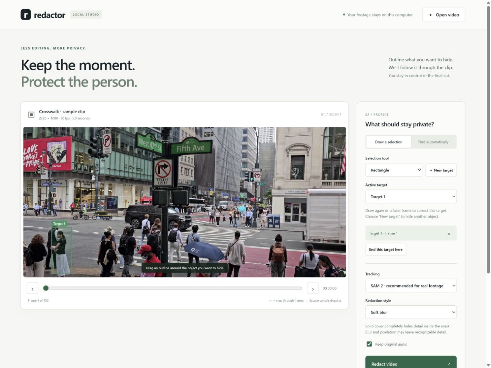

# Redactor

Select an object once, propagate its mask through a video, and export a redacted
copy. The CPU backend uses GrabCut, RANSAC similarity transforms, periodic
segmentation, appearance monitoring, and multiscale re-detection. The original
translation-only tracker remains available for comparison.

The research prototype includes a [final report](docs/final-report.md),
[measured results](docs/results.md), and a [12-second demo](videos/redactor-demo/redactor-demo.mp4).
On the evaluated DAVIS subset, SAM 2 reaches 0.835 mean IoU and 2.21% mean
visible-pixel leakage. This is not a guarantee of leak-free redaction.



## Run

Use Python 3.11 (tested) or newer. For the local browser interface:

```sh
python -m pip install -r requirements-lock.txt
python app.py
```

Open **http://127.0.0.1:8765**. Draw a freehand outline or rectangle, add targets,
seek to a later frame to correct a selection, and export. The app shows processing
progress, plays the result, and links flagged frames back to the selection view.
All processing stays on this machine. Uploaded videos and exports are saved in
`output/studio`; app sessions are in memory, so restart the app only after an
export finishes. Existing files remain on disk after restarting.

Use **Preview mask** to inspect segmentation before processing the clip. Green
shows the selected backend's initial mask; the faint edge shows the configured
extra coverage. Preview works for selections on the displayed frame and for
automatic detections. It is a fresh segmentation of that frame, not a replay of
earlier tracking memory. Changing the frame, prompt, backend, or margin clears
the old preview. Preview and export share the model worker and cannot overlap.

For the command line:

```bash
python -m pip install -r requirements.txt
python redact.py data/crosswalk-short.mp4
```

Draw a freehand outline slightly outside the object. Press Enter to preview,
Enter to accept, R to redraw, or Escape to cancel. The default output is
`output/crosswalk-short-redacted.mp4`. Each export also saves its prompts and a
frame-by-frame review log. FFmpeg preserves input audio and produces H.264 MP4;
use `--no-audio` to permit a video-only export without FFmpeg.

```sh
python redact.py clip.mp4 --box 100 80 220 300 --style solid
python redact.py clip.mp4 --prompts selections.json --mask-dir output/masks
python redact.py clip.mp4 --backend baseline --on-failure predict
python redact.py data/crosswalk-short.mp4 --backend sam2 --prompts examples/crosswalk.json
python redact.py clip.mp4 --backend sam2 --text "the woman in a white skirt"
python redact.py clip.mp4 --detect faces plates
python redact.py clip.mp4 --detect faces --detector haar
python redact.py clip.mp4 --backend learned --box 100 80 220 300 --style solid --margin 8
```

Boxes are exclusive `[x1, y1, x2, y2]` coordinates in the original video. Repeat
`--box` for multiple targets. A JSON prompt file can add targets or correct an
existing target at any frame:

```json
{"version": 1, "prompts": [
  {"id": "person", "frame": 0, "box": [100, 80, 220, 300]},
  {"id": "person", "frame": 60, "box": [160, 90, 260, 290]},
  {"id": "person", "frame": 100, "action": "end"},
  {"id": "second", "frame": 40, "polygon": [[10, 20], [80, 20], [80, 150], [10, 150]]}
]}
```

Masks can also be supplied as a `"mask": "relative/path.png"` entry. Existing
outputs are protected unless `--overwrite` is supplied. Input and output must
always be different files.

CLI mask prompts save PNG sidecars next to their JSON; keep those files together
when moving a replay. Browser selections download as self-contained geometry.

Use an `"action": "end"` prompt, or **End this target here** in the browser, when
review confirms that the target has left. This stops redacting that instance
from the specified frame onward. A later selection can introduce it again.

SAM 2 and Grounding DINO require the optional [model setup](docs/models.md).
Grounding DINO accepts descriptions or the face/license-plate presets; the Haar
face option works with the base dependencies. Detection runs on every frame by
default, assigns separate instance IDs, and picks up later arrivals. Increase
`--detect-every` for speed at the cost of potentially missing new targets between
detection frames. Detector failures and identity ambiguity still need review.

## Review and limitations

Uncertain or lost tracking produces a solid covered frame by default, recorded
in the review log. Use `--on-failure stop` to abort and add a corrective prompt.
`--on-failure predict` exports uncertain predicted locations for research and
can expose the target. Covered frames are a request for review, not evidence
that tracking worked. Undetected errors remain possible with all policies.

Classical appearance recovery is limited by pose changes, similar-looking
objects, and partial occlusion. A Gaussian blur is not a guarantee of anonymity;
use `--style solid` when identifying detail must be completely covered, and
review the entire output before sharing.

**Extra coverage** in the studio, or `--margin N` in the CLI, expands coverage
by N source pixels on each side. The default remains 4 (the proposal's 9×9
dilation). Wider margins cover more surrounding detail and can reduce boundary
leaks, but cannot fix a lost or undetected target. Reports record the margin.

The optional `learned` backend replaces classical recovery with frozen ResNet-18
features. It is experimental: our paired real-video evaluation found worse
average DAVIS tracking than the classical recovery method. SAM 2 remains the
recommended real-footage backend. See the [proposal follow-up](docs/proposal-followup.md)
for the learned-recovery comparison, crowded-frame prompt ablation, and coverage
trade-off measurements. A [midterm report draft](docs/midterm-report.md) is also
available; it is not a record of a course submission.

## Evaluation

See [evaluation notes](docs/evaluation.md) for metrics, reconstructed synthetic
fixtures, and the DAVIS reader. The original proposal is [581proposal.pdf](581proposal.pdf).

```sh
python scripts/evaluate.py --output results/comparison.json
```

## Test

```bash
python -m pytest -q
```

Set `REDACTOR_MODEL_TESTS=1` to include the installed SAM 2 integration test.
`python scripts/check_models.py` also checks three known Grounding DINO examples
after downloading the crosswalk and DAVIS assets described in the evaluation
guide. The pinned base/UI/test environment is `requirements-lock.txt`; optional
model versions used for the reported results are in `results/environment.json`.
