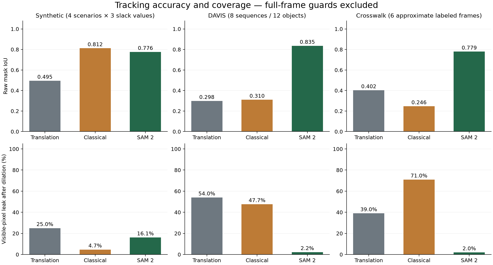
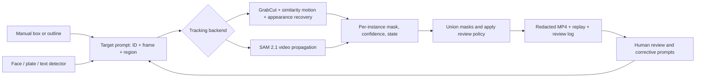

# Redactor: select-once video redaction

Final implementation and evaluation · 11 October 2026

## Outcome

The proposal's end-to-end research prototype is implemented: manual, class, and
text prompts feed interchangeable classical and SAM 2 trackers; multiple targets
can enter, receive corrections, and end at different frames; the local review
interface exports video, replayable selections, and a per-frame review log.

The central research objective—reliably covering every visible target pixel
while keeping the mask tight—is **not universally solved**. On the evaluated
DAVIS subset, SAM 2.1 Tiny improves mean mask IoU from 0.298 to 0.835 and reduces
mean visible-pixel leakage from 53.98% to 2.21%. The classical improvements are
effective on controlled scale change and scene cuts but remain fragile on real
pose changes and occlusion. Review is part of the delivered workflow.

## Problem and priorities

The [proposal](../581proposal.pdf) prioritizes privacy coverage over mask
tightness. A good average IoU can still hide a short, serious exposure; a
full-frame black mask can eliminate exposure while destroying the video's
usefulness. We therefore measure localization, visible-pixel leakage, temporal
exposure, and excess redaction independently.

The starting repository contained a small OpenCV tool: lasso selection,
GrabCut segmentation, median Lucas–Kanade translation, and a dilated Gaussian
blur. Its translation model could not resize a mask or reliably recover after
occlusion. The evaluation script cited by the proposal was absent. This work
preserves that baseline and reconstructs the experiments without claiming to
reproduce the proposal's original numbers.

## System design

`TargetPrompt` is the shared interface. It carries an instance ID, a zero-based
frame index, and a box or coarse mask; an `end` action retires an active target.
Prompts are applied only when their frame is reached. A later correction does
not supply information to earlier frames. JSON supports boxes, polygons, and
relative PNG masks. The browser preserves original polygon geometry in its
download so replay does not depend on inaccessible image sidecars.

The classical tracker initializes with GrabCut. It checks forward/backward
optical flow, fits a RANSAC similarity transform, and periodically refines the
mask with cropped GrabCut. A frozen appearance histogram and multiscale masked
template provide a recovery anchor. Competing template matches are rejected.
Histogram and spatial frame differences detect cuts. Lost tracks are labeled
explicitly instead of silently accepting stale masks. This remains a template
tracker, not a learned identity model.

The alternative uses the official SAM 2.1 Hiera Tiny checkpoint and video API.
A coarse outline becomes a box, a foreground point, and negative points in
outline holes. Frames enter through quality-100 JPEGs. Video and inference
state are offloaded to CPU memory to fit a 6 GB GPU. Empty masks, low positive
mask confidence, and detected cuts trigger review; a scene-cut flag persists
until a new prompt confirms that instance. Positive-logit confidence is a
heuristic, **not a calibrated probability that the target is covered**.

Grounding DINO provides referring-expression, face, and license-plate prompts.
The lightweight OpenCV frontal-face detector is also available. Spatial overlap
associates detections with existing IDs; it is not biometric identity tracking.
Detection runs every frame by default so later arrivals can be found. Class
presets filter label tokens; overlapping part/whole detections from one text
query are suppressed. Missed detections remain possible before a target has
ever been discovered.

Rendering unions active masks, dilates by 9×9 pixels, and applies blur, pixelation,
or solid cover. The default policy covers an entire uncertain frame and records
it for review. `stop` aborts for correction; `predict` is an explicit research
mode that can expose lost targets. Output is written to a temporary directory
and published only after video encoding succeeds. Existing outputs require an
overwrite option; input and output cannot be the same file. FFmpeg preserves
source audio when requested.

## Evaluation protocol

All primary comparisons use raw predicted masks, including uncertain frames.
Full-frame export guards are scored in a separate table. Every run resets the
OpenCV random seed to 581 and uses one OpenCV thread. No subsequent ground-truth
mask is passed to propagation or recovery.

* **Synthetic:** 4 deterministic 90-frame scenarios—translation, shrink to 45%
  scale, full pillar occlusion, and a cut at frame 45. Six methods at 5/9/13-pixel
  initial slack produce 72 runs. The reconstructed `person-v1` fixture supplies
  exact visible-object masks. Its results are development-set evidence because
  classical parameters were developed on these scenarios.
* **DAVIS 2017:** 8 convenience-selected clips / 12 annotated objects: blackswan,
  bmx-trees, breakdance, car-roundabout, drift-chicane, libby, horsejump-high, and
  soapbox. Three methods at 5-pixel slack produce 36 runs. Each object receives
  its first prompt on its first visible frame. This is a varied subset, not the
  full DAVIS validation benchmark and not a randomized held-out study.
* **Crosswalk:** all 150 frames are tracked; six manually traced visible-person
  polygons are scored at frames 0/30/60/90/120/149. Labels are approximate,
  sparse development annotations, not expert-reviewed dense ground truth.
  They include clothing and the shoulder bag and exclude the pink carried box
  where separable. No model prediction was used as annotation truth.

IoU is measured before dilation. Leak rate is the proportion of visible object
pixels outside the dilated prediction. Fully occluded frames have no leak
denominator. Reports retain frame-weighted and pixel-weighted leak, worst-frame
leak, leaking-frame fraction, longest contiguous exposure, and excess covered
frame area. Contiguous exposure duration is deliberately unavailable for sparse
crosswalk labels. Summary values below macro-average object sequences; they are
not pooled pixel statistics.

Hardware: Intel Core Ultra 7 255H, NVIDIA RTX 4050 Laptop GPU (6 GB), Windows,
Python 3.11, PyTorch 2.11.0+cu128. [Environment versions](../results/environment.json),
source digests, model hashes, and per-frame results accompany the runs. Model
loading and JPEG preparation are separate from propagation timing. Timing is a
single local run, not a repeated performance study; other local development
activity can affect it. It excludes output encoding.

## Results and interpretation

| Dataset | Method | Mean IoU | Mean raw leakage |
|---|---|---:|---:|
| Synthetic, all slack values | Translation baseline | 0.495 | 24.98% |
| Synthetic, all slack values | Classical + recovery | 0.812 | 4.68% |
| Synthetic, all slack values | SAM 2.1 Tiny | 0.776 | 16.14% |
| DAVIS subset | Translation baseline | 0.298 | 53.98% |
| DAVIS subset | Classical + recovery | 0.310 | 47.67% |
| DAVIS subset | SAM 2.1 Tiny | 0.835 | 2.21% |
| Crosswalk, six approximate labels | Translation baseline | 0.402 | 39.02% |
| Crosswalk, six approximate labels | Classical + recovery | 0.246 | 70.96% |
| Crosswalk, six approximate labels | SAM 2.1 Tiny | 0.779 | 1.98% |

At 5-pixel slack, similarity motion improves synthetic shrinking-object IoU
from 0.456 to 0.906. Recovery improves synthetic cut IoU from 0.440 to 0.911,
with zero measured leakage in that fixture. Occlusion leakage drops from 50.0%
to 18.3%, but partial occlusion still defeats the template before recovery.
These are useful improvements, not evidence of a general solution.

SAM 2 performs poorly on the synthetic occlusion fixture (48.9% raw leakage at
5-pixel slack) but substantially better on real footage. On DAVIS bmx-trees/1,
its mean IoU is only 0.443 and leakage is 9.3%; the overall average must not hide
this failure case. The detailed tables include worst frames and streaks.

The classical export guard covers 60.5% of DAVIS frames on average. It reduces
measured leakage to 9.29%, while excess redacted frame area rises from 4.1% to
58.3%. SAM 2 flags only 0.8% of DAVIS frames and its guarded leakage remains
2.04%. On the crosswalk run it flags no frames despite the approximately 1.98%
measured leakage. **No flags does not mean no leaks.**

Median DAVIS propagation speeds were 75.9 fps for the translation baseline,
7.2 fps for the classical recovery method, and 6.3 fps for SAM 2. SAM 2's
crosswalk run processed about 5.9 fps before setup and encoding. A separate
full-resolution 150-frame SAM 2 export took about 77 seconds end to end.

[Complete tables](results.md) include the six-method synthetic ablation and
per-object DAVIS results. JSON and CSV files prefixed `final-` are the final
comparison. Earlier result files preserve exploratory runs, including an older,
slower recovery search; they should not be mixed into the final aggregates.

## Validation and proposal coverage

| Proposal deliverable | Implementation and evidence |
|---|---|
| Shared manual / class / text target interface | `types.py`, `prompts.py`, `detection.py`; real known-example detector smoke checks |
| Multiple objects and late arrival | Independent classical trackers and SAM 2 object IDs; integration tests add and end a second instance |
| Scale-aware motion and refinement | Similarity RANSAC, forward/backward checking, periodic GrabCut; synthetic scale ablation |
| Confidence, cuts, and recovery | Appearance checks, cut monitoring, frozen-template recovery, explicit review states |
| SAM 2 comparison | Official installed model tested on all synthetic scenarios, DAVIS subset, and crosswalk |
| Real and synthetic benchmark | Reconstructed 72-run synthetic suite, 36-run DAVIS subset, sparse crosswalk annotations |
| Polished selection and review UI | Local browser studio, lasso/box, corrections, target ending, progress, cancellation, video/replay/log downloads |
| Iteration record | [Three development iterations](iterations.md), source history, preserved exploratory results |
| Final report and demo | This report, [30-second MP4](../videos/redactor-demo/redactor-demo.mp4), and editable HyperFrames source |

The test suite covers geometric bounds, metrics, sparse-label semantics,
recovery, prompt replay, late targets, target ending, default cover/stop policies,
atomic video failure, audio preservation, uploads, origin checks, and export
downloads. The optional test executes the installed SAM 2 model. Separate
[Grounding DINO smoke checks](../results/detector-smoke.json) find a described
person, a face, and a license plate in known real frames. These three examples
demonstrate working integration, not detector recall across a dataset.

The browser was checked at desktop and 390-pixel mobile widths. A full real SAM 2
export was played and inspected. Target ending and cancellation were exercised.
Automated file selection was blocked by the browser extension's file permission;
the multipart upload endpoint was validated through an integration test.
[UI review notes](ui-review.md) record that boundary. A Windows/Linux CI matrix
is configured; remote CI has not been run because changes have not been pushed.

## Practical limits and further research

This is a short-clip research tool, not a certified anonymization system. Blur
and pixelation can preserve recognizable detail; solid cover removes detail
only inside the chosen mask. Unflagged drift, thin boundaries, missed detections,
new identities, similar-looking objects, and camera cuts remain risks. SAM 2
loads frames and state into memory, so long videos can exceed available RAM.
Exports use a constant frame rate; variable-frame-rate timing is not preserved.
Audio is retained when requested and is not anonymized. The studio is intended
for loopback use, with one export at a time, not a public multi-user service.

The next research steps are dense independently reviewed crosswalk labels,
full held-out DAVIS evaluation, domain-specific face/plate recall evaluation,
calibrated uncertainty, robust identity recovery, and measured annotation effort
for correction workflows. Their absence limits the research conclusions; it is
not hidden behind the completed software deliverables. Course presentations,
TA feedback, and submission are human activities and have not been claimed.

## Reproduce and demonstrate

Follow [README](../README.md), [model installation](models.md), and
[evaluation commands](evaluation.md). Run `python scripts/summarize_results.py`
to regenerate all report tables and the figure from checked JSON.

The demo uses actual source footage and a real solid-cover SAM 2 export. Both
views use the same crop and 0.5× playback. The source capture is shown as a
capture, not simulated interaction. See its [reproduction notes](../videos/redactor-demo/README.md).

## References

* [Project proposal](../581proposal.pdf).
* [SAM 2 official source, model configuration, and checkpoint license](https://github.com/facebookresearch/sam2).
* [SAM 2 paper](https://arxiv.org/abs/2408.00714).
* [Grounding DINO official repository](https://github.com/IDEA-Research/GroundingDINO)
  and [Transformers integration](https://huggingface.co/docs/transformers/en/model_doc/grounding-dino).
* [DAVIS 2017 official data and evaluation resources](https://davischallenge.org/davis2017/code.html).
