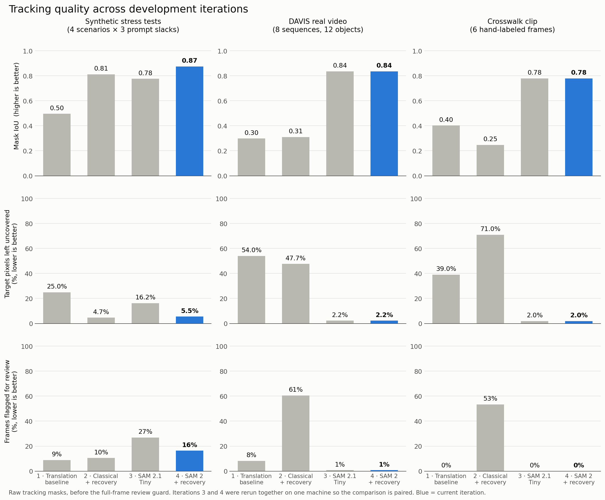
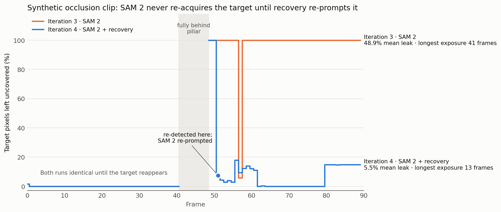

# Iteration 4: SAM 2 + appearance re-detection

## What the previous results showed

Iteration 3 adopted SAM 2.1 Tiny because it was far better on real video
(DAVIS leakage 47.7% → 2.2% versus the classical tracker). The same benchmark
showed it was the worst method on the synthetic occlusion test: 48.9% raw
leakage, against 18.3% for iteration 2's classical tracker with recovery.

## Diagnosis

The per-frame log shows SAM 2 tracks the target perfectly up to the pillar
and correctly reports it as hidden for frames 41–48. Then it never finds it
again: every frame from 49 to 89 is fully exposed, except for a one-frame
flicker at frame 57. SAM 2 conditions on a short window of recent frames plus
the first prompt. After a long occlusion that window contains only "no
object", and the first prompt was made on the other side of the frame.

The two earlier designs fail in opposite places. SAM 2 is strong at
frame-to-frame tracking but cannot re-acquire a lost target. Iteration 2's
frozen appearance template is weak at frame-to-frame tracking but good at
re-finding a target. Iteration 3 replaced the classical tracker outright, and
its recovery was lost with it. This iteration revisits that decision and
combines the two.

## Change

`redactor/sam_backend.py`:

1. When SAM 2 is confident about a user-prompted target, the target's
   appearance is frozen as a template, reusing `ClassicalTracker` from
   iteration 2 (`set_reference`, with no extra GrabCut pass).
2. After 2 frames without a confident mask, the template is matched across the
   whole frame at multiple scales. Weak or ambiguous matches are rejected.
3. A match is added back to SAM 2 as a mask prompt on that frame. SAM 2 keeps
   it as a permanent conditioning frame, and propagation restarts from there.
4. Such frames are logged with state `recovered` in the review log.

**First attempt failed.** Re-detection found the target, but SAM 2 discarded
the correction. SAM 2 stores a correction as a permanent conditioning frame
only if that frame has not been tracked yet. Recovery corrects a frame
that has already been tracked, so the mask was stored as ordinary memory and
overwritten when propagation re-ran it. Setting the predictor's documented
`add_all_frames_to_correct_as_cond` flag fixed this. User prompts are
unaffected, because they are always applied before their frame is tracked.

## Measurement

The paired rerun used one machine (RTX 4060 Laptop), with the same prompts and
benchmark for both methods. `sam2` is iteration 3 with recovery disabled. It
reproduces the previously recorded numbers (occlusion 48.9%, DAVIS 0.836 IoU),
so the comparison is fair.





Raw tracking masks (macro-averages; synthetic averages 3 prompt slacks):

| Dataset | Method | IoU | Leak | Review frames |
|---|---|---:|---:|---:|
| Synthetic occlusion | SAM 2 | 0.452 | 48.9% | 54% |
| Synthetic occlusion | SAM 2 + recovery | **0.847** | **5.9%** | **12%** |
| Synthetic, all 4 scenarios | SAM 2 | 0.776 | 16.2% | 26.9% |
| Synthetic, all 4 scenarios | SAM 2 + recovery | **0.875** | **5.5%** | **16.4%** |
| DAVIS, 12 objects | both | 0.836 | 2.22% | 0.7% |
| Crosswalk | both | 0.779 | 1.97% | 0.0% |

The longest continuous exposure on the occlusion clip fell from 41 frames to
13–17, depending on prompt slack. The translation, scale, and cut scenarios are
unchanged.

## Trade-offs and limits

- **Exported-video leakage on the occlusion clip rose from 0.09% to 3.47%.**
  Before, the default export blacked out the entire frame while SAM 2 was lost
  (53.9% of the frame redacted beyond the target). Now those frames get a
  target-shaped mask (13.6% excess), which misses some pixels as the target
  emerges from the pillar. The video is far more usable, but it is not
  strictly safer. Use a wider `--margin` if this matters.
- **No effect on real footage.** On DAVIS and crosswalk, SAM 2 never lost a
  target for 2+ frames, so recovery never ran and every per-object result is
  identical. This is not evidence of a real-world gain. It shows that the change
  costs nothing when it isn't needed. DAVIS bmx-trees/1 (leak 9.3%) remains the
  real occlusion failure; there, SAM 2 keeps a confident but partial mask, and
  this change does not address that.
- **Partial emergence still leaks.** Template matching needs most of the
  target to be visible, so frames 49–50 stay exposed. Frames 80–89 also show
  about 15% leakage after recovery, which is not yet diagnosed.
- **Wrong-target risk.** A lookalike could be re-detected. The ambiguity
  rejection reduces this risk, and recovered frames are logged for review,
  but they are not covered by default.
- **Speed.** Re-detection runs only while a target is lost. Median throughput
  was unchanged on DAVIS and crosswalk, and fell from 7.7 to 7.0 fps on the
  occlusion clip.

## Reproduce

```sh
python scripts/evaluate.py --methods sam2 sam2-recover --output results/occlusion-recovery-synthetic.json
python scripts/evaluate.py --davis data/DAVIS --sequences blackswan bmx-trees breakdance car-roundabout drift-chicane libby horsejump-high soapbox --methods sam2 sam2-recover --slack 5 --output results/occlusion-recovery-davis.json
python scripts/evaluate.py --annotations data/crosswalk-annotations.json --methods sam2 sam2-recover --slack 5 --output results/occlusion-recovery-crosswalk.json
python scripts/plot_progress.py
```

`REDACTOR_MODEL_TESTS=1 python -m pytest tests/test_sam_backend.py` includes a
regression test that requires re-acquisition after the pillar.
