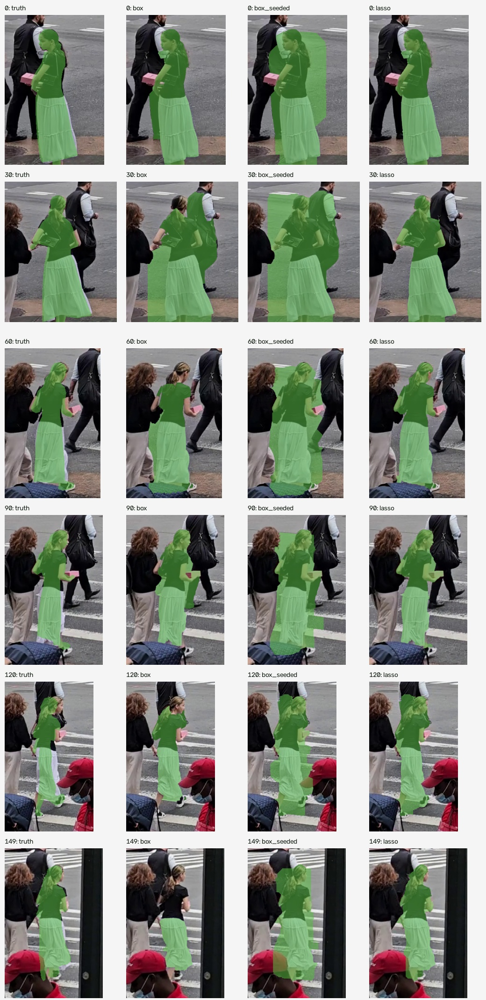
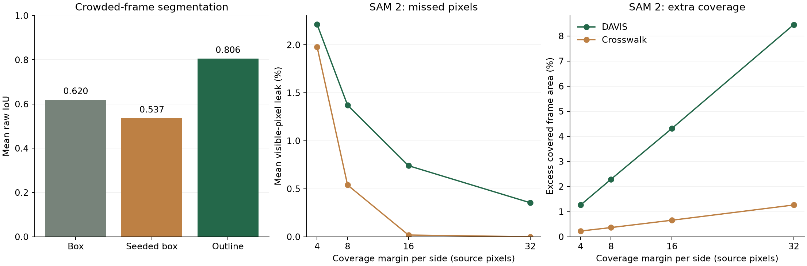

# Proposal follow-up

Measured on 11 October 2026. Generated by `python scripts/summarize_followup.py`.

The learned recovery extension, crowded-frame prompt experiment, browser segmentation preview, and configurable coverage margin are now implemented. A midterm draft and demonstration runbook are prepared. Reliable select-once, zero-leak redaction remains an open research objective; this report does not mark it solved.

## Crowded-frame box versus lasso

All six approximate crosswalk annotations are independently segmented at 5/9/13-pixel slack: 54 segmentations. Each pair shares its frame and slack. `box` uses the proposal's rectangle-initialized GrabCut; `box_seeded` uses the same seed rules as lasso on a rectangle. Thus the latter comparison isolates prompt geometry. IoU precedes dilation; leakage and excess use the original 9×9 coverage kernel.

| Prompt / initialization | Mean IoU | Mean leak | Excess frame area |
|---|---:|---:|---:|
| Box / rectangle initialization | 0.620 | 14.92% | 0.34% |
| Box / lasso seed rules | 0.537 | 0.06% | 0.77% |
| Outline / lasso seed rules | 0.806 | 0.53% | 0.24% |

The outline improves localization and reduces excess coverage in this clip. The seeded rectangle leaks least because it covers more background; lowest leakage alone is not best segmentation. This is evidence for the proposal's crowd hypothesis, not a general claim: six frames of one person are correlated, labels are approximate, and prompts are derived from those labels rather than drawn by users. No annotation-effort or statistical-significance claim is made.

[Raw prompt experiment](../results/prompt-ablation.json)

## Learned appearance recovery

The optional `learned` backend replaces the histogram/template recovery search with frozen ImageNet ResNet-18 layer3 features and multiscale, foreground-weighted spatial cosine matching. Motion estimation, histogram monitoring, and GrabCut refinement remain fixed. Competing matches are rejected. No network is trained or updated from these clips. Thresholds were fixed before the real-video comparison; learned features are not calibrated identity probabilities.

| Dataset | Recovery | Mean IoU | Raw leak | Guarded leak | Frames covered for review | Guarded excess |
|---|---|---:|---:|---:|---:|---:|
| Synthetic | classical | 0.812 | 4.68% | 0.00% | 10.5% | 12.2% |
| Synthetic | learned | 0.769 | 8.74% | 0.00% | 14.2% | 15.8% |
| DAVIS | classical | 0.310 | 47.67% | 9.29% | 60.5% | 58.3% |
| DAVIS | learned | 0.284 | 52.59% | 8.87% | 64.8% | 62.5% |
| Crosswalk | classical | 0.246 | 70.96% | 20.96% | 53.3% | 49.8% |
| Crosswalk | learned | 0.263 | 68.96% | 0.01% | 82.7% | 82.8% |

This is a negative accuracy result on the DAVIS subset. The learned option is retained for reproducible research and is labeled experimental in the UI; SAM 2 remains recommended for real footage. Extremely low guarded leakage on the crosswalk comes from covering most frames, not from accurate learned tracking. Spatial features still transfer the initial shape and can fail under pose change or partial occlusion.

The comparison contains 24 synthetic runs (4 scenarios × 2 methods × 3 slacks), 24 DAVIS runs (12 objects × 2), and 2 crosswalk runs. It uses the same convenience subset and sparse development labels as the original report. Some local tasks ran concurrently, so recorded timings are not a controlled speed study. [Synthetic](../results/recovery-synthetic.json), [DAVIS](../results/recovery-davis.json), [crosswalk](../results/recovery-crosswalk.json), and [model details](models.md#learned-appearance-recovery).

## Coverage versus excess redaction

Four margins are scored on each identical raw SAM 2 mask with no re-prompting or confidence-policy changes. A margin is the number of source pixels added on each side; 4/8/16/32 pixels correspond to 9/17/33/65 square kernels. These are raw-mask coverage results, without full-frame review guards. Excess is a fraction of the entire frame, not of the object. The worst frame is the maximum across scored objects/frames, while means macro-average object sequences.

| Dataset | Margin per side | Mean leak | Worst frame leak | Mean excess frame area |
|---|---:|---:|---:|---:|
| DAVIS | 4px | 2.21% | 57.10% | 1.27% |
| DAVIS | 8px | 1.37% | 39.04% | 2.29% |
| DAVIS | 16px | 0.74% | 25.15% | 4.32% |
| DAVIS | 32px | 0.35% | 20.75% | 8.45% |
| Crosswalk | 4px | 1.98% | 4.55% | 0.23% |
| Crosswalk | 8px | 0.54% | 1.28% | 0.37% |
| Crosswalk | 16px | 0.02% | 0.11% | 0.66% |
| Crosswalk | 32px | 0.00% | 0.00% | 1.26% |

Wider coverage reduces edge leakage at the cost of covering more surroundings. It does not repair identity switches, absent detections, or complete tracking failures. Even the largest tested margin leaves measured DAVIS exposure. The historical 4px default is retained; users can explicitly choose a larger margin in the browser or with `--margin`. Zero measured leakage on a sparse set of frames would not establish zero leakage throughout a clip.

[DAVIS coverage results](../results/coverage-davis.json) · [Crosswalk coverage results](../results/coverage-crosswalk.json)

## Review interface and validation

Preview mask runs the selected segmentation backend on the displayed frame without exporting a clip. It supports several manual targets and detector prompts. Green shows the mask and a fainter edge shows the selected margin. The preview is a fresh segmentation, not a reconstruction of earlier video memory. Changing the frame, selection, detector query, backend, or margin invalidates it; stale asynchronous responses are discarded. Preview and export cannot load models concurrently. SAM 2 preview uses the same quality-100 JPEG preparation as the video backend.

Tests exercise exact first-frame SAM 2 preview/export equality, classical mask and margin geometry, rejected file-path prompts and invalid frame indices, compute exclusion and failure cleanup, frozen learned weights, recovery after a scene cut, and rejection of duplicate-looking candidates. The complete local suite passed with installed model tests enabled. See [UI review](ui-review.md) for browser evidence.

## Remaining proposal obligations

| Obligation | Status |
|---|---|
| Proposed model/interface implementation | Implemented, including learned recovery and browser mask preview |
| Crowded real-frame box/lasso comparison | Completed on the six available crosswalk labels; broader crowd validation remains open |
| Three iterations compared on a benchmark | Available in the final report and the midterm draft |
| Final report, code, demo video | Present; report extended with these findings |
| Reliable select-once coverage with a tight mask | Not achieved; measured exposure and false confidence remain |
| Detect every face/plate, recover identity, infer permanent departure | Basic mechanisms exist; broad recall and identity reliability are not established; target ending remains manual |
| TA meeting / midterm submission / final presentation / final submission | Not performed or verified; draft and runbook prepared |

The original proposal's synthetic script was absent from the starting repository. The reconstructed fixture remains a reconstruction, not a reproduction of Table 1. No report claims otherwise. [Reproduction commands](evaluation.md#proposal-follow-up-experiments), [midterm draft](midterm-report.md), [demo runbook](demo-runbook.md).
