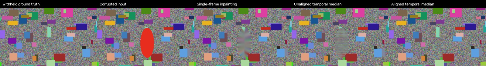
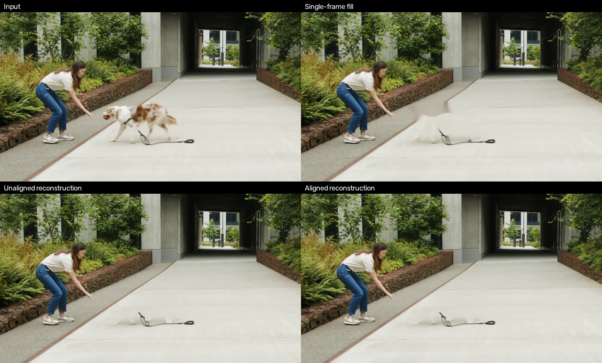

# First object-removal experiment

Measured November 1, 2026 on `temporal-object-removal`, for the November 2
meeting. This is a new reconstruction experiment, not a matched rerun of the
proposal's tracking benchmark. It establishes a starting point for further
iterations; it is not a claim of an original research algorithm.

## Pipeline and implementation

Text -> **Grounding DINO Tiny** box -> **SAM 2.1 Base+** video masks -> expanded
removal masks -> **our OpenCV background reconstruction** -> MP4 with source audio.
These are separate perception models and a non-neural reconstruction algorithm.
The text model's revision is pinned; the SAM checkpoint and source are pinned by
the existing setup. No model is trained and no generative video model is used.

The reconstruction caches ORB features outside expanded target masks, matches
source and target background features, and fits a homography with RANSAC. Fits
with too few inliers, poor inlier ratio, or implausible corner geometry are
rejected. Candidate images and their visibility masks are warped together.
A masked median combines visible observations; at least two sources are required.
Pixels with insufficient observations use OpenCV Telea inpainting. The target
frame itself is excluded from the source candidates. Ground-truth clean images
are never supplied to this stage.

This first version uses at most 17 evenly distributed frames from the whole shot.
It does not yet optimize source selection over time, compensate exposure, handle
parallax with local warps, mask other moving objects, or blend seams separately.
The implementation preserves pixels outside the expanded removal mask before
lossy video encoding. Actual video outputs are limited to 640 pixels wide and
300 frames in a single shot. Text selects the highest-scoring first-frame box;
its saved preview must be inspected. Automated language grounding can be wrong.

## Matched reconstruction comparisons

**30 method runs on 10 cases, 36 frames per case**, using the same frames, exact
masks, source access, and fallback settings for all three methods:

1. Single-frame Telea inpainting.
2. Unaligned masked temporal median, then the same fallback.
3. Aligned masked temporal median, then the same fallback.

The nine procedural cases use seeds **581, 582, 583** for each of stationary,
camera-pan, and never-visible conditions. The object is an opaque moving ellipse
on a textured planar background; the never-visible condition uses a fixed hole.
Motion and background deliberately satisfy the global-alignment assumptions.
This is a controlled unit benchmark, not evidence of general real-world quality.
The tenth case uses 36 frames from actual crosswalk footage (every fourth frame,
480x224) with an artificial moving hole. Uncorrupted pixels are held out for
scoring, including any naturally moving people in that footage.

**Mean absolute RGB error inside the removal mask, 0-255; lower is better.**
Procedural rows average three seeds; the natural row is one sequence.

| Condition | Single frame | Unaligned median | Aligned median |
|---|---:|---:|---:|
| Stationary planar background | 27.80 | **0.00** | 0.02 |
| Panning planar background | 27.95 | 32.29 | **0.82** |
| Background never visible | 27.95 | 27.95 | 27.95 |
| Natural crosswalk + artificial hole | 44.08 | 25.91 | **17.74** |

Alignment reduces error by **59.8% relative to single-frame filling** on the one
natural-video restoration case. Unaligned copying is worse than single-frame
filling in the controlled camera-pan cases. In the stationary case alignment is
unnecessary and adds small interpolation errors. If background is never visible,
none of the temporal methods improves over the shared spatial fallback: all
correctly report zero observation support there.

Temporal residual error compares successive reconstruction-error images only
where the removal masks overlap. It uses clean references to subtract genuine
scene changes; it is not a perceptual flicker score or an accuracy metric alone.

| Condition | Single frame | Unaligned median | Aligned median |
|---|---:|---:|---:|
| Stationary | 17.83 | 0.00 | 0.03 |
| Camera pan | 32.60 | 21.47 | 1.27 |
| Natural crosswalk | 40.33 | **11.70** | 12.34 |

The natural result is a useful negative finding: the aligned method improves
spatial fidelity but has slightly worse temporal residual error than unaligned
copying. This motivates testing temporal source consistency next. A constant
wrong reconstruction can have low temporal error, so both measures are needed.

Every method changed **zero pixels outside the mask before encoding**. In all
non-permanent benchmark holes there were at least two valid observations per
pixel. Support means available observations, not correct background or calibrated
confidence. PSNR and every frame's values are retained in the JSON; PSNR uses an
MSE floor of 1e-12 for exact recovery. Metrics are computed before MP4 compression.
Times include reconstruction/scoring loop overhead and are not controlled speed
comparisons. CPU benchmark platform and implementation hash accompany the data.

Data: [full per-frame JSON](../results/removal-benchmark.json),
[summary CSV](../results/removal-summary.csv).



## Actual removal demos

All three methods receive the same masks. Source/output contact sheets were
inspected for every frame of all three demos; this is visual validation, not
hidden-background ground truth.

| Clip | Selection | Frames | Observations |
|---|---|---:|---|
| Original proposal crosswalk target | Text: `woman wearing a white skirt` | 150 | Correct person selected; temporal reconstruction removes her with much less smearing than spatial filling. Other pedestrians can leave ghosting, and crowded overlap is difficult. |
| SAM gallery dog clip | Text: `dog` | 37 | Correct dog selected and pavement recovered in many frames. Leash and some associated shadow remain outside the target mask; seams and local texture artifacts remain. |
| Crosswalk light-jacket target | Reuse previously validated SAM masks | 150 | Person removed; foreground overlap and moving-background pedestrians produce occasional ghosts. This isolates reconstruction from rerunning tracking. |

The white-skirt detector score was **0.820**, and the dog score was **0.919**.
These are detector scores, not probabilities or measured grounding accuracy.
Two prompts do not establish general language-selection reliability. All runs
used one initial selection, with no corrective prompts. SAM gallery footage was
previously sampled every eight frames with playback rate adjusted accordingly.
The real demos use 3-pixel dilation at their working resolution. No dense
reconstruction accuracy is claimed for their genuinely hidden backgrounds.

Open the [meeting demo page](removal-demo.html). It contains all
comparison videos and the controlled camera-pan/failure examples. Generated
media lives in ignored `output/` and can be regenerated with the commands below.



## Validation and reproducibility

The complete Allegro suite passed **30 tests**, including three actual-model
integration tests and five reconstruction/CLI tests. New checks verify that
masked source pixels never contaminate a reconstructable background, permanently
hidden pixels are not claimed as observed, known camera translation is recovered,
output stays unchanged outside the mask, cached masks run without loading model
weights, frame count is preserved, and the source cannot be overwritten.
The existing FastAPI dependency emits one deprecation warning.

GPU text/tracking: Allegro RTX A6000, PyTorch 2.7.1+cu118. Reconstruction is CPU
OpenCV; numerical comparisons ran locally on macOS. Detailed demo metadata and
source hashes are in [real-demo report](../results/removal-real-demos.json) and
[verification](../results/removal-verification.json).

```sh
python -m pytest -p no:capture -q -m "not model"
REDACTOR_MODEL_TESTS=1 python -m pytest -p no:capture -q
python scripts/benchmark_removal.py
python scripts/remove_object.py data/crosswalk-short.mp4 --text "woman wearing a white skirt" -o output/removal/white-skirt-text.mp4
python scripts/remove_object.py output/rewrite-smoke/01_dog-source.mp4 --text dog -o output/removal/dog-text.mp4
python scripts/remove_object.py data/crosswalk-short.mp4 --masks output/rewrite/light-jacket.masks -o output/removal/light-jacket.mp4
```

The dog source can be regenerated using the earlier `scripts/smoke_clips.py`;
that script also processes masks for its redaction checks. Existing outputs need
`--overwrite`. Setup instructions and text dependencies are in the root README.

## What to discuss at the meeting

- We retain the proposal's target-selection/tracking infrastructure but are
  exploring object removal through observed-background reconstruction.
- Our implemented experiment isolates reconstruction: adding temporal evidence
  helps, camera movement makes naive copying fail, and alignment repairs much
  of that failure under the tested assumptions.
- The contribution so far is a modular implementation and controlled evaluation,
  not a novel segmentation model or a demonstrated novel reconstruction method.
- The next hypothesis is that consistent source selection can reduce ghosting
  and temporal changes without sacrificing spatial accuracy. It is not yet built.
- Ask whether this scope change and planned evaluation are appropriate for the
  course. These reconstruction scores must not be inserted into the proposal's
  tracking IoU table or presented as a direct comparison with that baseline.
