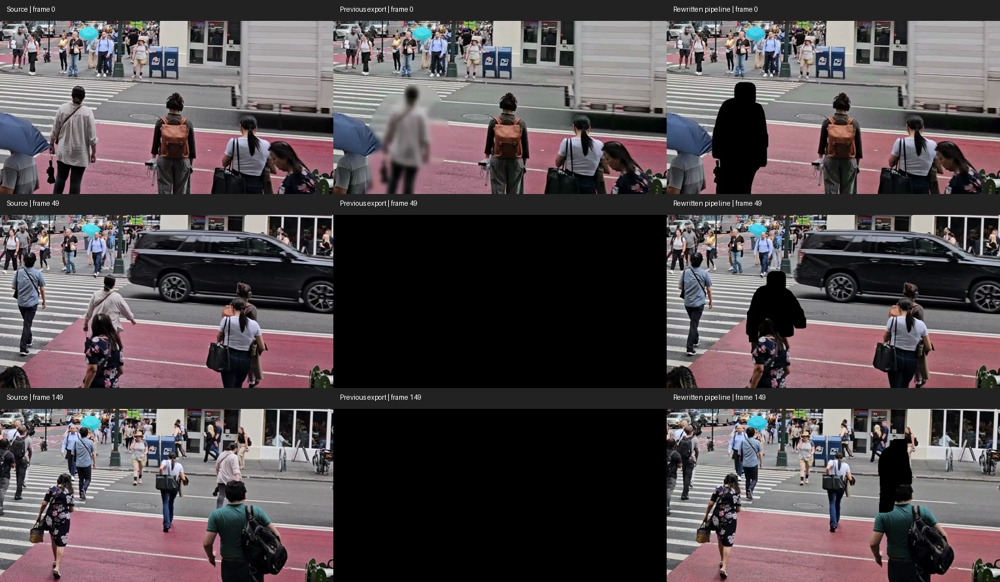

# Rewrite validation

Validated on 1 November 2026, on branch `codex/pipeline-rewrite`. The runtime uses
one fixed model, **SAM 2.1 Base+**, with manual boxes and corrections. The old
classical trackers, detector association, learned recovery, and configuration
menus have been removed.

## The previously failing clip

The exact original selection is preserved in `examples/light-jacket.json`.
Its old coarse outline is now converted to a bounding box, matching the new UI.
Generating positive/negative points from that outline produced a fragmented
initial mask even on CPU; removing that conversion was a necessary simplification.

The five-second, 150-frame crosswalk clip selects the light-jacket pedestrian.
The previous local classical export started covering the entire frame at frame
39 and blacked out 111 of 150 frames. The rewritten pipeline processed all 150
frames using only the initial selection, with no corrective prompts:

| Check | Result |
|---|---:|
| Decoded output frames | 150 |
| Output frame rate | 30 fps |
| Full-frame blackouts | 0 |
| Independent visible-target checkpoints covered | 38 / 38 |
| Nearby-person checkpoints incorrectly covered | 0 / 15 |
| Review flags | 0 |
| End-to-end processing time | 56.4 seconds |

All 150 raw masks were visually inspected in source-frame contact sheets. The
mask retained the selected pedestrian through the foreground crossing and later
partial occlusions. No identity switch was observed. The point annotations were
chosen on the source before inspecting the new full-clip predictions. They are
interior checks, not dense boundary labels: these results do not establish zero
pixel leakage at every edge.



The local result is `output/rewrite/light-jacket.mp4`; raw masks and the detailed
processing log are beside it. Quantitative checks are retained in
`results/rewrite-light-jacket.json` and source checkpoints in
`data/light-jacket-checkpoints.json`.

## Additional real footage

Two official SAM 2 gallery clips were sampled every eight frames, retaining the
original resolution and adjusting the frame rate to preserve playback duration.
Each received one initial box and no corrections. Every resulting mask was
visually inspected against its source frame.

| Clip | Frames | Observation |
|---|---:|---|
| Moving/jumping dog | 37 | Target retained through pose changes; tracking resumed after the dog left and returned to the frame |
| Rotating/pouring kettle | 36 | Target retained through rotation and hand overlap; no review flags |

The dog produced five appropriate review flags around departure/re-entry
(frames 9, 10, 11, 12, and 14). Frames 10 through 12 contain no visible dog.
The preview preserves the scene during this absence, and its final export is
withheld pending review. The model did not switch to the person. There are no
dense independent masks for these clips, so these are visual smoke checks,
not numerical segmentation-accuracy claims.

Sources, initial boxes, frame stride, and model metadata are recorded in
`results/rewrite-real-smoke.json`. Reproduce with `python scripts/smoke_clips.py`
after model setup.

## Controlled coverage tests and model choice

The unchanged deterministic `person-v1` fixture was run for 30 frames each for
translation, shrinking scale, and full pillar occlusion. Each run received only
an initial bounding box. Later ground truth was used only for scoring. IoU scores
raw masks; leakage scores the same resolution-based coverage expansion used by
the application. There is no blackout guard in these measurements.

| Scenario | Base+ mean IoU | Base+ mean leakage | Large mean IoU | Large mean leakage |
|---|---:|---:|---:|---:|
| Translation | 0.963 | 0.99% | 0.921 | 3.45% |
| Scale change | 0.943 | 0.00% | 0.931 | 0.00% |
| Full occlusion | 0.861 | 3.81% | 0.811 | 9.19% |

SAM 2.1 Large also passed the crosswalk checkpoint checks and all software/model
integration tests. Base+ performed better on these controlled coverage cases,
so it remains the single production checkpoint. This was a quality choice;
the Allegro GPU had enough memory for either checkpoint. These are development
fixtures and a small real-video sample, not proof that Base+ is universally
better than Large. The 30-frame protocol also differs from the historical
90-frame experiments and must not be mixed into their aggregates.

Coverage is improved, not perfect. Base+'s worst synthetic frame leakage was
14.79% for translation and 18.47% for occlusion. Its longest leaking streaks
were two and six frames respectively. Review of thin boundaries and difficult
occlusions remains necessary. The application flags missing masks but cannot
identify every incomplete or incorrect mask.

Full per-frame numbers are in `results/rewrite-synthetic.json` and
`results/rewrite-large-synthetic.json`; the larger model's crosswalk checks are
in `results/rewrite-large-light-jacket.json`.

## Software and real-model checks

**25 tests passed** on Allegro, including real model inference. All 32 local
source, test, and configuration files matched the GPU-tested copy byte for byte;
their hashes are retained in `results/rewrite-verification.json`. Checks cover:

- Tracking from a later selection backward and forward, with each frame returned once.
- Scale change with a later corrective selection available during processing.
- Exact agreement between lazy frame preprocessing and the official loader.
- Fresh inference state per shot, with review required for unselected shots.
- Empty predictions preserving the preview instead of producing black frames.
- Final-download gating and explicit review approval.
- Cancellation, failed/incomplete processing, source-file protection, and atomic encoding.
- Frame count, audio preservation, uploads, saved selections, and local request validation.

The installed CLI and browser-app entry points were also checked. The simplified
browser interface was exercised locally for box drawing, actual model selection
preview, and frame stepping. Software tests with test doubles verify application
behavior; the separate actual-model tests and footage checks support the tracking
findings above.

Hardware/runtime: Allegro, NVIDIA RTX A6000 (48 GB), driver 550.54.15, Python
3.12.15, PyTorch 2.7.1+cu118, TorchVision 0.22.1+cu118, OpenCV 5.0.0. Model
checkpoint checksum and official source revision accompany each report. The
end-to-end time above is one run and includes preparation and encoding; it is not
a controlled timing comparison between model sizes. No full-clip CPU/Mac-GPU
performance claim is made. A newer PyTorch 2.15.0 Mac-GPU build failed an early
propagation diagnostic, which is why the tested runtime is pinned.

## Reproduce

```sh
REDACTOR_MODEL_TESTS=1 python -m pytest -q
python redact.py data/crosswalk-short.mp4 --prompts examples/light-jacket.json -o output/rewrite/light-jacket.mp4
python scripts/validate_rewrite.py output/rewrite/light-jacket.json
python scripts/evaluate.py --frames 30 --output results/rewrite-synthetic.json
python scripts/smoke_clips.py
```

Existing results require `--overwrite` for another processing run. On the local
Anaconda-based Python installation, importing its system `readline` crashes the
standard pytest capture plugin; the local application tests were run with
`python -m pytest -p no:capture -q -m 'not model'`. The complete CUDA suite also
used `-p no:capture` and passed all 25 tests.
