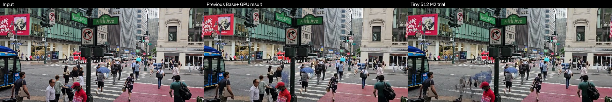

# Runtime experiment: M2, November 7

The normal command now computes only the final aligned reconstruction. It uses
at most eight source frames and enables CPU parallelism. Base+ remains the
tracking model after a smaller-model comparison showed an unacceptable loss of
instance accuracy. Its internal input is 512 pixels, with float16 autocast on
Metal; CUDA continues to use bfloat16. Output remains 640 pixels wide.

## Reconstruction comparison

Same 36-frame crosswalk restoration fixture, identical masks, same scoring,
full-shot source access. Timings include background feature setup and processing,
but exclude video encoding, text detection, and SAM. Single passes in the listed
order on an interactive M2 laptop; these are not statistical confidence intervals.

| Setting | Seconds | Masked RGB MAE, lower better |
|---|---:|---:|
| Previous settings: 17 sources, serial, all three methods | 93.77 | 17.74 |
| Final reconstruction only, 17 sources, serial | 119.79 | 17.74 |
| Final only, 8 sources, serial | 63.98 | 18.53 |
| Final only, 8 sources, native parallelism | 20.74 | 18.53 |

The combined configuration was 4.5 times faster in this component test, with a
4.5% increase in masked RGB error. The final-only row was slower despite doing
less work, illustrating wall-time variability; the runs were not randomized.
Do not attribute every difference to one change or extrapolate 4.5x to the whole
application.

This OpenCV build uses macOS GCD. `setNumThreads(1)` disables parallel loops;
a request for four enables the native pool but does not enforce a four-thread
cap. The build reports eight. Production detects GCD and requests automatic
parallelism instead of reporting a misleading fixed cap. Other builds request
at most four threads.

## Model and precision comparison

Both models used the same initial box and the same 31 sampled crosswalk frames,
including the six existing polygon annotations. Both had 512-pixel internal
inputs. SAM timings include state initialization, prompt segmentation, propagation,
and scoring overhead; JPEG preparation and model loading are separate. Sampling
changes motion between frames, so this is not the full-video tracking protocol.
Annotations are approximate and sparse; no continuous exposure duration is claimed.

| Configuration | Tracking seconds | Mean sparse IoU | Mean sparse leakage after 3-pixel expansion |
|---|---:|---:|---:|
| Tiny, float32 | 67.36 | 0.552 | 2.61% |
| Base+, float32 | 183.18 | 0.769 | 0.97% |
| Base+, Metal float16 autocast | 119.33 | 0.760 | 1.35% |

Base+ half precision reduced this measured tracking time by 35%, with a small
accuracy reduction on these six annotations. It is the chosen tradeoff for this
prototype. Tiny was faster but its masks expanded onto nearby pedestrians.

A separate full 150-frame Tiny trial confirmed that failure: mean sparse IoU
was about 0.38, and late-frame coverage included unrelated people. Its end-to-end
M2 time was 459.5 seconds, including startup and the first reconstruction run.
This negative trial is in `runtime-tiny-trial.json`.

The default-resolution Tiny trial was interrupted before completing; no finished
runtime or quality result is claimed for it. The earlier A6000 runs use different
hardware and must not be treated as before/after M2 timing comparisons.

## Startup and output

Text weights are now loaded from the local pinned cache first, with downloading
as a fallback. PyTorch CPU work uses up to four threads. Cold library/model startup
still adds substantial time on this laptop. Process sampling showed dynamic
library imports during the slow selection stage, so its whole delay cannot be
attributed to network checks or to detector inference alone.

Normal runs no longer render comparison videos or write hundreds of mask PNGs.
They save a selection preview, selection JSON, and one compressed `masks.npz` file
alongside the final video and processing report. Stage timings are printed and
saved, and the selected tracking device is explicit.

The reconstruction control retains 17 sources for historical comparability;
`benchmark_runtime.py` measures the optimized settings and model alternatives.
The latter requires both official checkpoints. The normal setup downloads only
Base+. The optional Tiny checkpoint is available from Meta's pinned SAM 2.1
release at:
`https://dl.fbaipublicfiles.com/segment_anything_2/092824/sam2.1_hiera_tiny.pt`,
SHA-256 `7402e0d864fa82708a20fbd15bc84245c2f26dff0eb43a4b5b93452deb34be69`.

All measurements here used the M2 directly. Allegro was unreachable; no new CUDA
validation or synchronization is claimed for these November 7 changes.

## Completed full video

The full 150-frame, 30 fps M2 output is `output/demos/crosswalk-fast.mp4`.
It took **763.65 seconds (12 minutes 44 seconds)**: decode 9.21 s, text selection
187.49 s, model loading 16.67 s, tracking/frame preparation 481.16 s, mask
preparation 0.44 s, background features 7.42 s, reconstruction 56.17 s, and
rendering/encoding 5.02 s. The component improvements do not make this a practical
live local demo. No matched full before/after Base+ M2 speedup is claimed.

All 150 source/output frames were inspected. Six approximate labeled frames
scored mean IoU **0.759**, mean expanded-mask leakage **1.22%**, and no frames
had empty masks. This does not establish dense boundary accuracy or perfect
background reconstruction. Moving-background ghosts and seams remain visible.

The full nine-test suite, including three actual-model tests, passed on the M2
on November 7. See [verification](runtime-verification.json). Generated videos and
model weights are ignored by Git and remain local.
